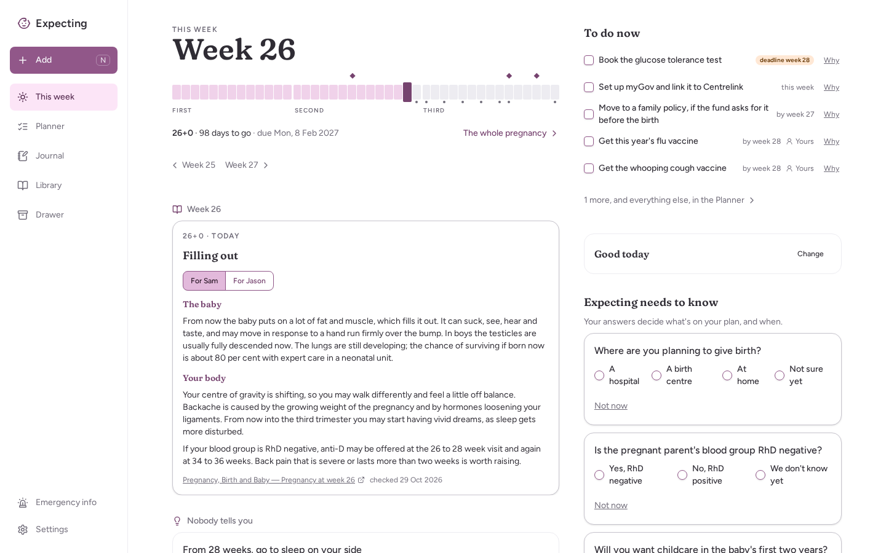
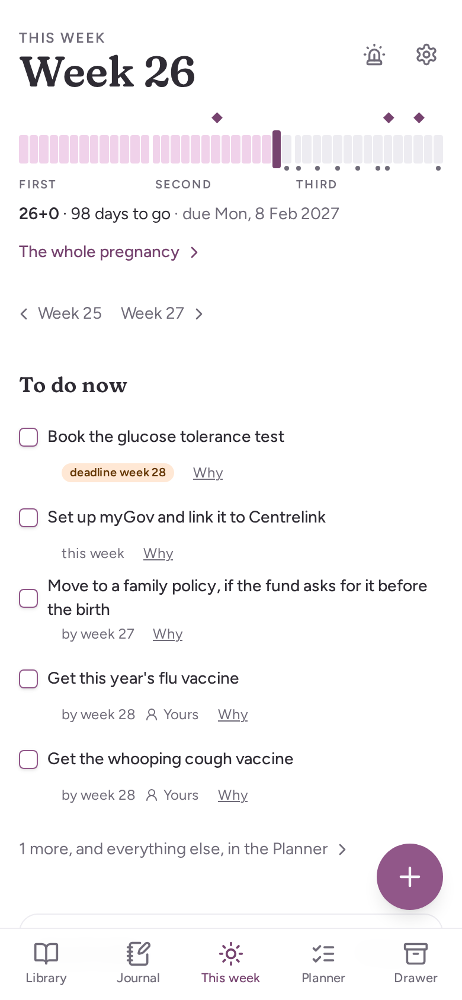
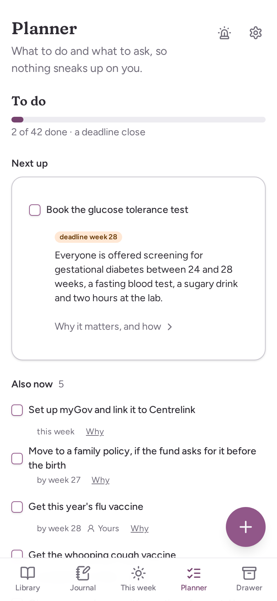
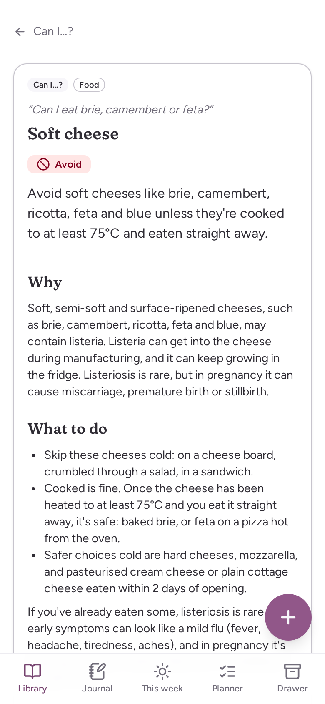
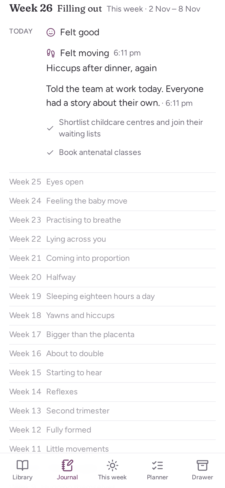

# Expecting

A pregnancy companion for two parents in Australia, running on your own
server. It runs the admin ("book the morphology scan by week 16", "claim
Parental Leave Pay this week"), says what to expect week by week, and keeps
what happens, in one space you both share, on your phones and at the
computer.

It was built for one couple and is public so others can run it too. It is
not a product: there's no hosted version, no account to sign up for, and no
support line.



**Why you might be here:**

- **You're expecting and wondering if it's for you:** [What it does](#what-it-does), then [Is it for you?](#is-it-for-you)
- **You want to run it:** [Run it](#run-it)
- **It's already running and you need to do something:** [Looking after it](#looking-after-it)
- **You're here for the writing:** [The content](#the-content)
- **You want to work on the code:** [Working on it](#working-on-it)

## What it does

<p>
  
  
  
  
</p>

People open a pregnancy app for different reasons, and each one has its own
place:

| When you're asking… | Expecting has… |
|---|---|
| Where are we? | **This week:** the baby, your body, a part for the partner, and a short read each day after it |
| What do we need to do? | **To do:** every booking, claim and purchase your answers make yours, with when it opens, when it's best done by, any hard deadline, and whose job it is |
| Can I eat brie? Is this normal? | **The Library:** some 900 entries from Australian sources, each from its source, by the question you came with |
| What do we need to get? | **Lists:** what to have ready before the birth (sleep, feeding, out and about, …), each line on its week, and the hospital bag |
| What do I ask at the appointment? | **Appointments**, with the questions you've saved for each |
| A kick, a scan photo, a bad day | **The Journal:** notes, movements, feelings, photos, papers, the firsts, and a book of it at the end |
| Names, who does what, who to tell | **The Drawer:** the names game and other things you do together |
| It's started | **It's time** (from week 36): big buttons, the bag, who to call |

Your answers tailor all of it: public or private care, a first baby or not,
twins, each of your jobs and leave. A question you haven't answered comes
back in the week it starts to matter. Anything else, like a baby shower, a
babymoon or a doula, is an extra you turn on.

It installs to the home screen and keeps working with no signal, for the
hospital's Wi-Fi. You can also connect Claude to it, so you can ask "what's
on this week?" or "add a question for the midwife" from a chat.

More: [what each part does, and why](docs/product/README.md), and
[the thinking behind it](docs/intent.md).

## Is it for you?

- **You're in Australia.** The admin is Australian: Medicare, public and
  private care, Services Australia, the national immunisation schedule,
  state birth registration. Elsewhere, the dates and the entitlements will
  be wrong.
- **You're pregnant.** It covers weeks 1 to 42. Getting ready before a
  pregnancy and the months after the birth aren't built yet.
- **There are two of you, or one.** Each parent has an account and sees
  everything the other adds. A single parent, or a partner running the
  admin alone, is a whole setup.
- **Someone can run a Docker container,** on a machine that stays on at
  home.

What it won't do:

- **Tell her what to do about her body.** It's directive about bookings,
  claims and purchases; about her body it explains what usually happens
  and points to the midwife or OB. Anything that should be a phone call
  says so, with your birth suite's number one tap away.
- **Read your results or score your mood.** It keeps scans and papers and
  finds them; it never says what's "normal".
- **Keep cheering if something goes wrong.** If you tell it something has
  happened, it stops the weeks and offers support in their place, for both
  of you ([how](docs/product/quiet.md)).
- **Send your data anywhere.** Everything stays on your machine. Nothing
  calls out: no analytics, no third-party scripts or fonts. The only
  exception is Claude, if you connect it.

## Run it

You need a machine on your network with [Docker](https://docs.docker.com/get-docker/) and Compose. From `docker/`:

```bash
docker compose up -d
```

Open `http://<that machine>:9966` and **set it up straight away**: the
first visit asks which of you you are (carrying or partner), your name and
your password, and until then whoever reaches the page first gets to. Then
invite the other of you from Settings.

The image is `ghcr.io/sixthshift/expecting:latest`, published on every
push to `main`. To build your own instead, see
[development](docs/development.md#building-the-image).

### Reaching it from your phone

- **At home,** the address above works, but your phone will only install
  it to the home screen and keep it working offline over **HTTPS**. Put it
  behind a reverse proxy with a certificate, or use
  [Tailscale](https://tailscale.com/kb/1153/enabling-https) with HTTPS on.
- **Away from home,** keep it off the public internet: it holds health
  papers. A VPN such as Tailscale is the intended way in.
- **Connecting the Claude app** is the exception: Anthropic's servers have
  to reach it, so it needs a public HTTPS address. See
  [Claude](docs/product/mcp.md).

### Settings in `docker/.env`

| Variable | Default | What it does |
|---|---|---|
| `EXPECTING_DATA_DIR` | `./data` | The folder on the host that holds everything |
| `EXPECTING_LOGIN` | `on` | `off` stops asking for passwords (each phone still says which of you is holding it). Only for a home network you trust |
| `EXPECTING_IMAGE` | the published image | Run another image, such as one you built |

## Looking after it

- **Updating:** `docker compose pull && docker compose up -d`. The database
  updates itself on start, and each phone shows what's new once.
- **Backing up:** everything is in `docker/data/` (the database and your
  photos and papers), and nothing else is. Back that folder up with the
  rest of the machine, and try a restore once before you rely on it.
  `docker compose down` leaves it alone.
- **A forgotten password:** the other of you can make you a reset link in
  Settings.
- **Alone and locked out:** put `EXPECTING_LOGIN=off` in `docker/.env`,
  run `docker compose up -d`, choose a new password in Settings, then take
  the line out and run it again.
- **Someone else set it up first, or you want a fresh start:** stop the
  container and delete `docker/data/`. That deletes everything.

## The content

The writing is the larger half of Expecting, and it's all in the repo as
Markdown:

- `content/items/`: about 900 Library entries, each one of eight types
  (a moment, a payment, a decision, a "can I?", a symptom, a guide, a card,
  a term), with its sources.
- `content/weeks/`: a note for each week, in three parts: the baby, your
  body, and for the partner.
- `content/days/`: a short read for each day after it.

Every claim comes from a source, Australian first (healthdirect's
Pregnancy, Birth and Baby, Services Australia, RANZCOG, the state health
departments). It's written and reviewed by Claude against those sources,
not by a midwife. How an entry is written is
[`content/README.md`](content/README.md); the bar it's reviewed against,
and the calls already made, [`content/REVIEW.md`](content/REVIEW.md). A
file that breaks the format fails the build.

## Working on it

TanStack Start (React 19) on Bun, SQLite through Drizzle, Tailwind, one
Docker container. A hand-written service worker and an outbox for saves
made offline. Claude connects over MCP.

You need [Bun](https://bun.sh) 1.4 or newer.

```bash
bun install
bun run dev        # http://localhost:9966
```

Before every commit, the gate (CI runs the same):

```bash
bun run check && bun run test && bun run lint && bun run e2e
```

`bun test` is a different runner and won't work.

Which doc answers what:

| You want to know… | Read |
|---|---|
| Why it exists, who it's for, the principles every part keeps | [`docs/intent.md`](docs/intent.md) |
| What a part does, and why it does it that way | [`docs/product/`](docs/product/README.md) |
| How it's built, and where the code is | [`docs/architecture.md`](docs/architecture.md) |
| The dev server, tests, ports, the image, releases | [`docs/development.md`](docs/development.md) |
| How to write a Library entry | [`content/README.md`](content/README.md) |
| The rules a change must keep (for Claude Code, and for you) | [`CLAUDE.md`](CLAUDE.md) |

Commits are [Conventional Commits](https://www.conventionalcommits.org/),
and the `feat:` and `fix:` subjects become the release notes the two of
you read on your phones, so write them for the two of you ("the names
game", not "add NamesGame component").
